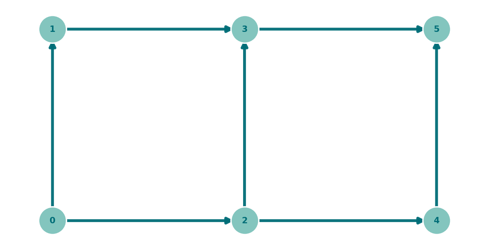

# Embeddings and plotting

Coordinates have two roles in the graph API. They identify vertices and provide an embedding from which the graph derives local orientation information. A plotting layout is a separate choice that controls how you view the graph.

This distinction matters in a quantum-geometric calculation. Changing the actual embedding can change the orientation signs used by an operator. Choosing a different layout for a figure leaves the graph and its signs unchanged. Neither the plotted length of an edge nor the area enclosed on the screen is, by itself, a quantum-geometric observable.

## Choose planar or three-dimensional conventions

For `Graph`, the `is_planar` flag selects how coordinates are used. A planar graph uses the first two coordinates for its stored plotting positions and computes orientation signs for ordered pairs of incident edges. A non-planar graph uses all three coordinates and computes signs for ordered triples.

The flag does not perform a topological planarity test. A graph can have crossings in a particular drawing and still be treated with planar conventions. Conversely, selecting `is_planar=False` does not move coplanar vertices into three dimensions or ensure nonzero triple signs.

The [supplied graph families](construction.md#start-from-a-graph-family) use `non_planar` to request three-dimensional conventions. For most families, this also replaces their initial coordinates with a deterministic three-dimensional labelling. If specific endpoint coordinates are part of your setup, supply them directly to `Graph`.

`graph.graph_positions` maps vertices to the two- or three-dimensional coordinates used for the stored embedding. `graph.dual_graph_positions` places each line-graph vertex at the midpoint of its corresponding original edge. A planar vertex still has a three-entry label, even though its third coordinate is not used in these two-dimensional positions or pair signs.

## Inspect local orientation signs

`graph.signs` is a dictionary indexed first by a canonical `Vertex`, then by an ordered pair or triple of stored `Edge` objects. For planar graphs, the pair convention uses the clockwise ordering of incident directions together with their incoming or outgoing orientations.

For three-dimensional graphs, the sign comes from the determinant of three outward-pointing tangent directions at the vertex. It is positive or negative according to their handedness, and zero when the determinant vanishes within the numerical tolerance. Exchanging two directions reverses a nonzero sign.

```python
import neuralqx as nqx

origin = (0, 0, 0)
x = (1, 0, 0)
y = (0, 1, 0)
z = (0, 0, 1)

graph = nqx.graph.Graph(
    [(origin, x), (origin, y), (origin, z)],
    is_planar=False,
)

vertex = graph.vertices[0]
ex, ey, ez = graph.edges

print(graph.signs[vertex][(ex, ey, ez)])
print(graph.signs[vertex][(ey, ex, ez)])
```

```text
1
-1
```

In this example the tangents follow the three coordinate axes. The table describes a local embedding convention. A geometric observable such as volume also depends on its operator definition and quantum labels, so a nonzero sign alone is not a volume measurement. See [LQX models](../lqx/index.md) for the geometric operators associated with a particular theory.

Parallel links have identical endpoint directions before further conventions are applied. For three-dimensional sign computation, neuraLQX assigns small deterministic tangent perturbations to distinguish these links. The key ordering participates in this convention. The curves drawn to separate parallel edges in a figure are a visual aid and are not the tangents used in this calculation.

## Make a reproducible random embedding

When you want a random three-dimensional embedding, pass `random_embedding=True` to a non-planar graph. Each distinct vertex receives three Gaussian coordinates. The defaults are mean `0.0`, standard deviation `5.0`, and seed `123`. You can set all three parameters explicitly to record your choice.

```python
import neuralqx as nqx

origin = (0, 0, 0)
x = (1, 0, 0)
y = (0, 1, 0)
z = (0, 0, 1)
edges = [(origin, x), (origin, y), (origin, z)]

options = {
    "is_planar": False,
    "random_embedding": True,
    "random_embedding_mean": 0.0,
    "random_embedding_std": 1.0,
    "random_embedding_seed": 7,
}
graph = nqx.graph.Graph(edges, **options)
same_graph = nqx.graph.Graph(edges, **options)

old_vertex = graph.original_edges[0].start
new_vertex = graph.embedding_map[old_vertex]

print(graph.edges == same_graph.edges)
print(new_vertex == graph.edges[0].start)
print([edge.key for edge in graph.edges])
```

```text
True
True
[0, 0, 0]
```

This operation preserves connectivity, edge order, keys, and directions under the vertex replacement. `original_edges` retains the canonical edge list from before randomisation, while `embedding_map` maps its vertices to the new ones. For a graph family, those original edges are the ones passed to `Graph` after any deterministic family relabelling.

The random embedding has its own seed and does not use the JAX random stream of a network or sampler. Selecting a reproducible graph embedding therefore does not also seed your variational calculation. Random embedding requires non-planar conventions, so combining it with `is_planar=True` is rejected.

Since randomisation changes the actual coordinates, it can change local sign tables and operators that depend on them. Record the embedding choice as part of the physical and numerical setup when those signs matter.

## Plot and save a graph

`graph.plot()` uses Matplotlib and returns a `(figure, axes)` pair. By default it displays the figure. With `show=False`, you can save the returned figure or compose it with other Matplotlib work without opening a window.

Use `layout="coordinates"` when you want to inspect the stored embedding:

```python
import matplotlib.pyplot as plt
import neuralqx as nqx

graph = nqx.graph.Grid2D(3, 2)
figure, axes = graph.plot(
    show=False,
    layout="coordinates",
    figsize=(7.5, 4.6),
    node_color="#83c5be",
    edge_color="#006d77",
    label_color="#006d77",
)

figure.savefig("grid.png", dpi=160, bbox_inches="tight")
plt.close(figure)
```



This writes `grid.png` in the current directory. To display a figure interactively instead, call `graph.plot(layout="coordinates")` in a session with a suitable Matplotlib backend. Vertex annotations show the zero-based positions in `graph.vertices`, rather than coordinate triples, edge indices, or quantum labels. Pass `with_labels=False` to hide them.

The default plotting layout is `"spring"`. It arranges vertices for visual separation using the graph's connectivity, so it can be useful for inspecting a dense graph. Set `seed` in `plot` to reproduce that arrangement. This is a plotting seed, separate from `random_embedding_seed`. Changing it changes the figure without replacing vertices or recomputing orientation signs.

The dimensionality of the plot follows `graph.is_planar`. Planar plots use directed arrows and separate parallel links with curves. Non-planar plots use three-dimensional axes. You can adjust their viewpoint with `elev` and `azim`, for example:

```python
import matplotlib.pyplot as plt
import neuralqx as nqx

graph = nqx.graph.K5Graph(random_embedding=True, random_embedding_seed=7)
figure, axes = graph.plot(
    show=False,
    layout="coordinates",
    elev=20,
    azim=35,
    label_color="#006d77",
    reference_mesh=False,
    depth_colorbar=False,
)

figure.savefig("k5.png", dpi=160, bbox_inches="tight")
plt.close(figure)
```

Camera angles affect only the view. In three-dimensional plots, colour can also encode viewing depth. The depth colourbar describes this visual effect, rather than a spin, charge, or geometric observable. The example disables that colourbar and the reference mesh for a simpler figure.

## Show the line-graph dual

Set `include_dual=True` to overlay the [line-graph dual](connectivity.md#work-with-the-line-graph-dual). Its vertices are placed at the midpoints of the displayed original edges, with connections between edges that share an original vertex.

```python
import matplotlib.pyplot as plt
import neuralqx as nqx

graph = nqx.graph.SingleVertexGraph(3)
figure, axes = graph.plot(
    show=False,
    layout="coordinates",
    include_dual=True,
    node_color="#83c5be",
    edge_color="#006d77",
    dual_color="#e29578",
    label_color="#006d77",
)

figure.savefig("star-and-dual.png", dpi=160, bbox_inches="tight")
plt.close(figure)
```

The star's three links become the three vertices of a dual triangle. This overlay shows adjacency between original edges. It should not be read as a dual cell complex of quantum geometry.

For further styling options, including node sizes, edge widths, figure resolution, and existing axes, consult the [graph API reference](../../api/public/neuralqx/graph/index.md). Once you have checked the graph you intend to use, continue to [Hilbert spaces](../hilbert/index.md) to assign its quantum degrees of freedom.
