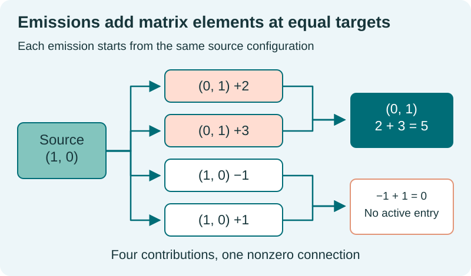

# Emissions and matrix elements

An emission contributes one candidate connection during an iterator visit. It consists of an update $T$, a matrix element $a$, and an optional condition. For an input configuration $\sigma$, its contribution is

$$
A_{\sigma,\sigma'}
=\mathbf 1_{p(\sigma)}\,
a\bigl(\sigma,T(\sigma)\bigr)\,
\delta_{\sigma',T(\sigma)}.
$$

The update selects the connected configuration. The matrix element supplies its coefficient. Neither one alone determines the operator. The coefficient can read the input and the completed target using the [selector interface](expressions.md).

## The four emission methods

All built-in emissions use the `matrix_element` keyword, defaulting to one. Omitting the update gives the identity update. `tag` is an optional diagnostic label.

| Method | Contribution |
| --- | --- |
| [`emit(update, matrix_element=...)`](../../../api/public/neuralqx/operator/symbolic/index.md#neuralqx.operator.symbolic.SymbolicDiscreteJaxOperator.emit) | Adds an independent branch subject to the term's `where` condition |
| [`emit_if(predicate, update, matrix_element=...)`](../../../api/public/neuralqx/operator/symbolic/index.md#neuralqx.operator.symbolic.SymbolicDiscreteJaxOperator.emit_if) | Starts a conditional chain and adds its first branch |
| [`emit_elseif(predicate, update, matrix_element=...)`](../../../api/public/neuralqx/operator/symbolic/index.md#neuralqx.operator.symbolic.SymbolicDiscreteJaxOperator.emit_elseif) | Adds an alternative that requires all earlier conditions in that chain to fail |
| [`emit_else(update, matrix_element=...)`](../../../api/public/neuralqx/operator/symbolic/index.md#neuralqx.operator.symbolic.SymbolicDiscreteJaxOperator.emit_else) | Adds the remaining alternative and closes the chain |

The older `amplitude` keyword remains an alias. Use `matrix_element` in new definitions to distinguish the operator coefficient from a wavefunction amplitude. If both are supplied, the alias takes precedence, so do not supply both.

## Row convention and ladder operators

The input to connectivity is a matrix row. Its output coefficient is $\langle\sigma|A|\sigma'\rangle$. This is easy to confuse with starting from the ket $|\sigma\rangle$ and applying $A$.

For a truncated occupation basis $n=0,1,2$, the annihilation operator satisfies $a|n\rangle=\sqrt n|n-1\rangle$. Its row at $n$ connects to column $n+1$,

$$
\langle n|a|n'\rangle
=\sqrt{n+1}\,\delta_{n',n+1}.
$$

Accordingly, the symbolic row update increases the occupation. The following example checks that convention against the explicit matrix.

```python
import numpy as np
import neuralqx as nqx
from neuralqx.operator import symbolic as s

graph = nqx.graph.Graph(
    [((0, 0, 0), (1, 0, 0))], is_planar=True
)
hilbert = nqx.hilbert.HomogeneousDiscreteHilbert(
    graph, nqx.hilbert.LocalRange(0, 1, 3)
)
n = s.site("i").value

annihilation = (
    s.SymbolicOperatorBuilder(hilbert, "annihilation")
    .for_each_site("i")
    .where(n < 2)
    .emit(s.shift("i", 1), matrix_element=(n + 1).sqrt())
    .compile()
)
expected = np.array([
    [0, 1, 0],
    [0, 0, np.sqrt(2)],
    [0, 0, 0],
])
np.testing.assert_allclose(annihilation.to_dense(), expected)
```

[`HomogeneousDiscreteHilbert`](../../../api/public/neuralqx/hilbert/index.md#neuralqx.hilbert.HomogeneousDiscreteHilbert) and [`LocalRange`](../../../api/public/neuralqx/hilbert/index.md#neuralqx.hilbert.LocalRange) provide the finite occupation basis. The guard removes the nonexistent column at occupation three. A creation row instead decreases the occupation and carries $\sqrt n$.

## Independent emissions

Each emission starts from the original input. Multiple emissions in a term do not apply one after another. For $a+a^\dagger$, both directions contribute when they are admissible, so they need independent conditions.

```python
quadrature = (
    s.SymbolicOperatorBuilder(hilbert, "quadrature", hermitian=True)
    .for_each_site("i")
    .emit_if(
        n < 2, s.shift("i", 1),
        matrix_element=(n + 1).sqrt(), tag="annihilation_row",
    )
    .emit_if(
        n > 0, s.shift("i", -1),
        matrix_element=n.sqrt(), tag="creation_row",
    )
    .compile()
)
np.testing.assert_allclose(quadrature.to_dense(), expected + expected.T)
```

Two `emit_if` calls start two separate chains. At $n=1$, both branches contribute. Replacing the second call with `emit_elseif` would suppress the downward connection whenever the first condition holds, changing the operator.

For two unconditional branches, use two plain `emit` calls. To apply several changes to the same connected configuration, use one [update chain](updates/chaining.md) inside a single emission.

## Mutually exclusive alternatives

An `if / elseif / else` chain represents a piecewise coefficient or transition. With conditions $p_0,p_1,p_2$, the effective branch guards are

$$
g_0=p_0,\qquad
g_1=\neg p_0\land p_1,\qquad
g_2=\neg p_0\land\neg p_1\land p_2.
$$

The final `else` covers the complement of all earlier conditions. The term's `where` guard is also required for every branch.

```python
piecewise = (
    s.SymbolicOperatorBuilder(hilbert, "piecewise_cost", hermitian=True)
    .for_each_site("i")
    .emit_if(n == 0, matrix_element=1, tag="empty")
    .emit_elseif(n == 1, matrix_element=4, tag="single")
    .emit_else(matrix_element=9, tag="double")
    .compile()
)
np.testing.assert_allclose(piecewise.to_dense(), np.diag([1, 4, 9]))
```

Keep alternatives consecutive. A plain `emit`, a new iterator, or a term modifier such as `where`, `named`, or `max_conn_size` closes the current chain. An `emit_elseif` or `emit_else` without an open chain is a construction error. Give the term its name and shared conditions before starting the chain.

## Repeated targets and output capacity

Different visits and emissions can reach the same configuration. Their coefficients add,

$$
A_{\sigma,\sigma'}
=\sum_{b:T_b(\sigma)=\sigma'}a_b(\sigma).
$$

This addition is part of the operator's meaning. Two entries with coefficients two and minus two cancel. They do not describe two nonzero physical connections that should be counted separately.



```python
cancelled = (
    s.SymbolicOperatorBuilder(hilbert, "cancelled", hermitian=True)
    .globally()
    .emit(matrix_element=2, tag="positive")
    .emit(matrix_element=-2, tag="negative")
    .build()
)
combined = cancelled.compile()
raw = cancelled.compile(deduplicate_connected_components=False)

source = np.array([1], dtype=hilbert.dtype)
_, combined_values = combined.get_conn_padded(source)
_, raw_values = raw.get_conn_padded(source)
np.testing.assert_allclose(combined_values, 0)
np.testing.assert_allclose(raw_values, [2, -2])
assert combined.max_conn_size == 1
```

Default compilation derives a static upper bound on distinct targets and combines repeated connections at execution. An identically zero operator still has one zero padding slot. Other configurations can leave zero padding within a larger fixed bound. Padded positions are therefore not stable branch identifiers. Use tags and the [IR](ir.md) to identify the originating rule.

`deduplicate_connected_components=False` retains raw branch entries in padded connectivity. Their aggregate still defines the same matrix. Native `get_conn` coalesces repeated targets when producing its unpadded result. The [compiler connectivity guide](../../../developers/symbolic/connectivity.md) explains the static proofs and runtime aggregation algorithms.
