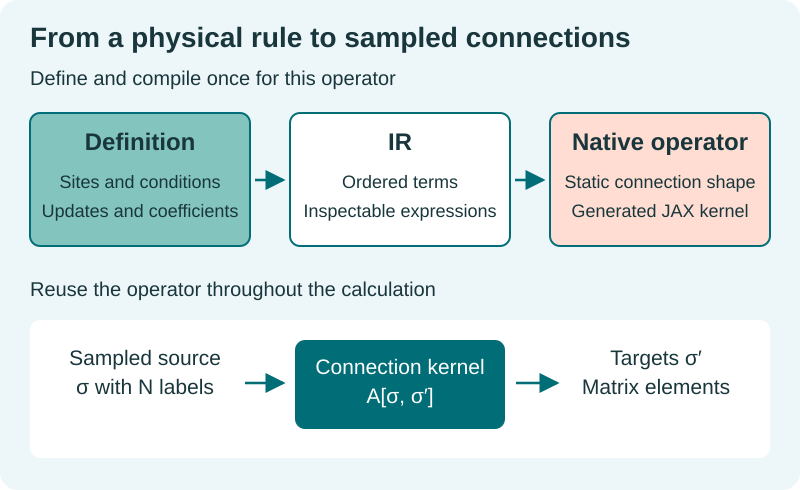

# Symbolic operators

A matrix free operator needs a rule for finding connected configurations and their matrix elements. Writing that rule directly in JAX also involves array shapes, batching, padding, and the treatment of repeated connections. These details are necessary for execution, but they are often separate from the physics you want to express.

[`neuralqx.operator.symbolic`](../../../api/public/neuralqx/operator/symbolic/index.md) provides a language for describing the physical rule. You specify where a term acts, when it contributes, how it changes configuration labels, and what coefficient accompanies that change. The compiler turns this definition into a native [computational operator](../../../api/public/neuralqx/operator/index.md#neuralqx.operator.ComputationalOperator). You can then measure it, combine it with other operators, or use it in a variational objective.

The language and compiler originated in the sister package nkDSL and are now maintained within neuraLQX. Use the `neuralqx.operator.symbolic` namespace shown throughout these guides. A separate nkDSL installation is not needed.



## Describe an action rather than a matrix

For a configuration $\sigma$, a rule produces another configuration $T(\sigma)$ with coefficient $a(\sigma)$. Its contribution to the operator is a matrix row,

$$
A_{\sigma,\sigma'}
=a(\sigma)\,\delta_{\sigma',T(\sigma)}.
$$

A complete operator sums such contributions over sites, graph structures, and alternative updates. The symbolic definition stores these rules. It does not store all basis configurations or allocate the matrix $A$.

This distinction is useful for LQG operators. A diagonal term can depend on charges, spins, or intertwiner labels without changing them. A transition can update selected labels and attach an amplitude computed from the original and resulting configurations. The physical interpretation still comes from the [Hilbert space and its layout](spaces.md). Calling a coordinate a site does not make it a graph vertex.

The compiler handles the numerical execution of the specified rule. It does not derive SU(2) recoupling coefficients, infer the intended boundary condition, or establish Hermiticity from an arbitrary expression. Those choices remain part of defining the operator.

## A first symbolic observable

The following operator measures the squared charge on one U(1) edge. Its configuration has one coordinate with possible values $-1,0,1$.

```python
import jax.numpy as jnp
import neuralqx as nqx
from neuralqx.operator import symbolic as s

graph = nqx.graph.Graph(
    [((0, 0, 0), (1, 0, 0))], is_planar=True
)
hilbert = nqx.hilbert.U1Hilbert(graph, cutoff=1)

definition = (
    s.SymbolicOperatorBuilder(hilbert, "charge_squared", hermitian=True)
    .for_each_site("e")
    .emit(matrix_element=s.site("e").value.pow(2))
    .build()
)
operator = definition.compile()

connected, matrix_elements = operator.get_conn_padded(
    jnp.array([1], dtype=hilbert.dtype)
)
print(connected.tolist(), matrix_elements.tolist())
```

```text
[[1]] [1.0]
```

[`SymbolicOperatorBuilder`](../../../api/public/neuralqx/operator/symbolic/index.md#neuralqx.operator.symbolic.SymbolicDiscreteJaxOperator) is the descriptive alias of `SymbolicDiscreteJaxOperator`. The iterator binds the label `"e"` to a flat site index. [`site`](../../../api/public/neuralqx/operator/symbolic/index.md#neuralqx.operator.symbolic.site) reads its charge, and `.pow(2)` squares that value. An emission with no update leaves the configuration unchanged, giving a diagonal matrix element.

`.build()` returns a symbolic definition that can be inspected. `.compile()` returns the executable operator. The builder also offers `.compile()` as a shortcut for both steps. The declaration `hermitian=True` is appropriate here because the operator is diagonal with real coefficients.

## The parts of a definition

An [iterator](iterators.md) chooses a static collection of sites or site tuples. A [condition](conditions.md) decides which visits contribute for the current configuration. An [emission](emissions.md) attaches an update and matrix element to a visit. The [update](updates/index.md) determines the connected configuration, while [expressions](expressions.md) determine its coefficient.

Several emissions can contribute during one visit. They each start from the same input configuration. If they reach the same target, their matrix elements are added by default. Consequently, the number of emitted rules and the number of distinct connected configurations need not agree.

All of this uses the matrix-row convention $A_{\sigma,\sigma'}=\langle\sigma|A|\sigma'\rangle$. A rule that increases a row's configuration label is not automatically a creation operator on kets. [Emissions and matrix elements](emissions.md#row-convention-and-ladder-operators) works through that distinction explicitly.

## From a definition to a simulation

The [first complete operator](first-operator.md) combines a diagonal charge term with cyclic transitions, checks its matrix on a small space, and measures it with a variational state. [Algebra and adjoints](algebra.md) explains sums, products, operator powers, and positive quadratic objectives. These operations use the same native interfaces as the [prebuilt operators](../prebuilt.md).

You do not need to learn compiler internals to use this language. Start with a small, physically meaningful action and verify a few rows. Increase the problem size after checking the local basis, boundary conditions, and coefficient conventions.

## Diagnostics and inspection {#diagnostics}

Compiler messages identify unresolved symbols, invalid indices, suspicious numerical expressions, and sampled connections outside the Hilbert space. The [diagnostics guide](diagnostics.md) explains how to investigate a message, and the [message reference](messages.md) covers every built-in diagnostic code.

The [intermediate representation guide](ir.md) shows how to read the definition after the fluent calls have been assembled. For performance analysis or compiler development, continue to the [developer guides](../../../developers/symbolic/index.md), which describe the passes and generated kernels.
