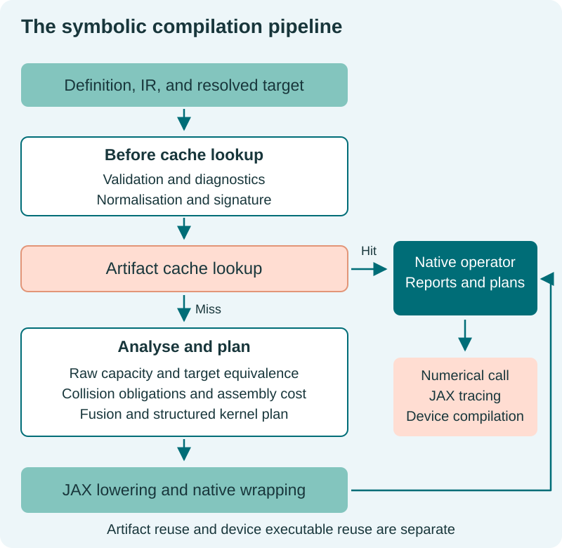

# Symbolic compiler

The symbolic compiler translates a declarative operator action into a native neuraLQX connection kernel. Its input describes configurations, conditions, updates, and matrix elements. Its output implements the same [computational operator contract](../operators/contracts.md) as a directly written JAX operator.

These guides are for developers who need to inspect compilation decisions, investigate performance, extend the language, or change the compiler itself. The [scientist guides](../../concepts/operators/symbolic/index.md) introduce the language and its physical conventions. Here we examine how the implementation preserves those conventions while constructing fixed-shape numerical work.

## The problem the compiler solves

Let an action index $r$ identify a term, an iterator visit, and an emission. The corresponding rule supplies a target $T_r(\sigma)$, a matrix element $a_r(\sigma)$, and an activity predicate $p_r(\sigma)$. The operator is

$$
A_{\sigma,\sigma'}
=\sum_r p_r(\sigma)\,a_r(\sigma)
\delta_{\sigma',T_r(\sigma)}.
$$

The compiler must represent this sum with arrays whose shapes are known to JAX. Different rules can reach the same target, guards can deactivate rules, and contributions can cancel. A direct allocation of one full target configuration per rule is correct when the capacity is sufficient, but can repeat considerable work.

The compiler therefore analyses target expressions before runtime. It combines targets that are provably identical, leaves unresolved collisions to exact runtime checks, and plans which scalar expressions and coordinate updates can be evaluated together. These transformations preserve the operator action. They do not replace the physical definition with a fitted approximation.



## Three different kinds of compilation work

Building a symbolic definition executes Python methods that construct an immutable intermediate representation. The builder's callbacks run at this stage to create expression trees. They do not run once for every sampled configuration.

Symbolic compilation validates that representation and generates a callable connection kernel. This stage also creates static connectivity and kernel plans. Its artifact contains the native operator, pass reports, and planning metadata.

JAX subsequently traces and compiles numerical execution for the argument shapes and dtypes encountered by the program. A successful symbolic compile does not imply that every future batch shape has already been compiled for the device. Keep these stages separate when investigating startup time, cache behaviour, and execution performance. The [lowering guide](lowering.md) follows that boundary in detail.

## Inspect an artifact

[`SymbolicCompiler`](../../api/public/neuralqx/operator/symbolic/index.md#neuralqx.operator.symbolic.SymbolicCompiler) exposes the artifact rather than returning only its executable operator. This small example inspects the compiler without assembling a dense matrix.

```python
import neuralqx as nqx
from neuralqx.operator import symbolic as s

graph = nqx.graph.Graph(
    [((0, 0, 0), (1, 0, 0))], is_planar=True
)
hilbert = nqx.hilbert.U1Hilbert(graph, cutoff=1)
definition = (
    s.SymbolicOperatorBuilder(hilbert, "charge_squared", hermitian=True)
    .for_each_site("e")
    .emit(matrix_element=s.site("e").value.pow(2), tag="diagonal")
    .build()
)

compiler = s.SymbolicCompiler()
artifact = compiler.compile(definition)
operator = artifact.compiled_operator
metadata = artifact.metadata_map()

assert operator.hilbert is hilbert
assert metadata["operator_lowering"] == "neuralqx"
print(artifact.backend, artifact.lowerer_name)
print(metadata["connectivity_deduplication"])
print(metadata["kernel_planning"])
```

The planning summaries expose bounded metadata, rather than all internal expression trees. Use them to understand a decision. Use measured execution to assess its performance. A small output capacity, for example, says nothing by itself about the cost of evaluating a neural network on those connections.

## Follow the representation into execution

The [language and IR guide](ir.md) describes the objects passed between the builder and compiler. The [pipeline guide](pipeline.md) explains the ordered passes and the cache boundary. [Connectivity analysis](connectivity.md) then derives the target classes, collision obligations, and padded capacity. [Kernel planning](kernels.md) separates scalar evaluation from target construction, and [JAX lowering](lowering.md) turns those plans into execution.

For investigations, [caching and configuration](configuration.md) documents every compiler option and the separate symbolic debug settings. [Compiler diagnostics](diagnostics.md) explains which checks are structural, sampled, or based on exact finite domains. [Extending the language and compiler](extensions.md) demonstrates custom clauses, passes, and operator targets.

The implementation is maintained inside `neuralqx.operator.symbolic`. Its compiler is integrated with native Hilbert spaces, pytrees, estimators, and operator algebra. Compiler findings use the `NQXDSL-` prefix and link to the [diagnostic message reference](../../concepts/operators/symbolic/messages.md).
