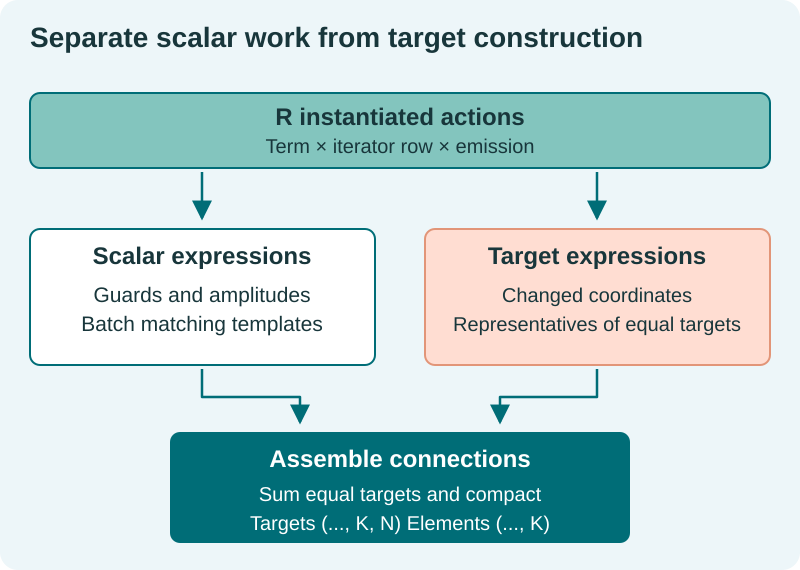

# Kernel planning

Connectivity analysis determines which contributions share a target and which collisions remain unresolved. Kernel planning uses that information to organise numerical work. Its central separation is between scalar expressions, such as coefficients and guards, and the construction of full connected configurations.

A configuration with $N$ coordinates and $R$ raw actions suggests an intermediate array of size $R\times N$. If many actions share targets or change only a few coordinates, constructing that array by replaying every update can duplicate work. A kernel plan retains the final coordinate expressions and materialises only the target representatives required by the [connectivity plan](connectivity.md).



## Instantiate actions

The planner's internal `KernelAction` record represents one term, iterator row, and emission. Its `origin` stores those three positions. Its bindings fix label-to-index mappings, while its expressions record the term predicate, emission predicate, and matrix element.

The target is represented by sparse coordinate expressions when possible. Dynamic destinations or unsupported static reasoning can produce an opaque target that retains its original update program. Opaque means the planner cannot fully resolve its coordinate map. It does not mean that the action is ignored.

The planner preserves ordered updates and dtype conversions. For example, replacing two integer writes with one real-valued expression is not valid if an intermediate cast changes the result. Likewise, an emitted-value coefficient must refer to the final target, not to an earlier partially updated configuration.

## Batch compatible scalar expressions

The internal `ScalarBatch` record groups expressions with the same operation structure and compatible evaluation semantics. Source indices become explicit input slots. Constants retain their values and types, and repeated reads of the same coordinate share a slot.

For example, $q_i^2+1$ evaluated on every site has one scalar template with different source indices. The implementation can evaluate that template along an action axis. In contrast, constants with different values are not automatically replaced by a generic parameter array merely to make their trees look alike.

`enable_fusion=True` permits compatible mapped actions to share such batches. A global conditional retains its scalar conditional structure and is not freely combined with mapped visits. This distinction helps preserve guarded evaluation rather than treating every predicate as an interchangeable multiplication by zero.

## Plan target materialisation

The plan stores one representative for each target-equivalence class, or every action when deduplication is disabled. At lowering, the coordinate scheduler chooses between two strategies.

`dense_select` applies shared local coordinate transforms and uses fixed masks to select which representative receives each result. It is selected when the transforms are local and unconditionally expressible in that form, there are at most eight coordinate-expression families, and the representative-by-coordinate table has at most 65,536 cells.

`sparse_scatter` evaluates the changed-coordinate expressions and scatters them into copies of the source. It handles more varied access patterns without allocating the same dense coordinate-selection tables. Opaque targets and global control-flow regions retain an update-program fallback where required.

The numerical axes are batch, action, and coordinate. They serve different roles. Batching samples does not increase the number of symbolic actions, while changing an iterator domain does. Increasing the number of target classes affects both target materialisation and downstream wavefunction evaluation.

## Inspect and compare plans

The following operator reflects each charge through zero using an affine update. The planned and reference kernels must implement the same independent dense reference. The plan summary also shows the effect of disabling scalar fusion.

```python
import numpy as np
import neuralqx as nqx
from neuralqx.operator import symbolic as s

graph = nqx.graph.Graph(
    [((0, 0, 0), (1, 0, 0)), ((1, 0, 0), (2, 0, 0))],
    is_planar=True,
)
hilbert = nqx.hilbert.U1Hilbert(graph, cutoff=1)
definition = (
    s.SymbolicOperatorBuilder(hilbert, "charge_reflection", hermitian=True)
    .for_each_site("e")
    .emit(s.affine("e", scale=-1, bias=0), matrix_element=1.0)
    .build()
)

planned = s.SymbolicCompiler().compile(definition)
reference = s.SymbolicCompiler(
    options=s.SymbolicCompilerOptions(optimize_kernels=False)
).compile(definition)
unfused = s.SymbolicCompiler(
    options=s.SymbolicCompilerOptions(enable_fusion=False)
).compile(definition)

basis = np.asarray(hilbert.all_states())
indices = {tuple(row): i for i, row in enumerate(basis)}
expected = np.zeros((len(basis), len(basis)))
for row_index, source in enumerate(basis):
    for coordinate in range(hilbert.size):
        target = source.copy()
        target[coordinate] *= -1
        expected[row_index, indices[tuple(target)]] += 1.0

for artifact in (planned, reference, unfused):
    np.testing.assert_allclose(artifact.compiled_operator.to_dense(), expected)

summary = planned.metadata_map()["kernel_planning"]
assert summary["enabled"]
assert reference.metadata_map()["kernel_planning"]["fallback_reason"] == "disabled"
assert unfused.metadata_map()["kernel_planning"]["scalar_batches"] >= summary["scalar_batches"]
print(summary)
```

The example includes zero charges, where reflection leaves a coordinate unchanged and actions can collide. Testing only nonzero charges would miss that part of the assembly behaviour.

## Conservative fallbacks

The current planner bounds its own construction work. More than 65,536 instantiated actions, more than 512 scalar batches, or more than 128 opaque targets select a reference-kernel fallback. The summary reports `action_budget_exceeded`, `scalar_batch_budget_exceeded`, or `opaque_target_budget_exceeded` as appropriate.

`per_site_modular_domains` indicates the basis-position modular implementation used for heterogeneous or non-unit local bases. Those updates remain supported through the general JAX path. `connectivity_analysis_missing` means a required plan was unavailable, while `disabled` reflects the requested configuration. A fallback is not a statement that the symbolic definition is physically invalid.

These are current implementation limits rather than public promises about future thresholds. Read the artifact's actual `fallback_reason` before assuming a particular optimisation was used.

## Preserve precision and evaluation regions

Scheduling can change when expressions are evaluated, so it must account for partial functions and floating-point behaviour. Square roots, division, and powers are kept within the required coordinate regions rather than blindly applied to all coordinates. Conditional regions are retained where scalar control flow requires them.

Specialisation also considers the configuration dtype, matrix-element dtype, and JAX precision settings. A unit modular shift can use a guarded selection only when its range and dtype assumptions hold. Precision-sensitive constant subgraphs can select the reference kernel to avoid changing sparsity through subnormal treatment.

These decisions explain why `kernel_planning` metadata describes a structural schedule rather than promising one fixed machine-code implementation for every input. Continue to [JAX lowering and execution](lowering.md) for the native shapes, conditional semantics, and measurement boundaries.
