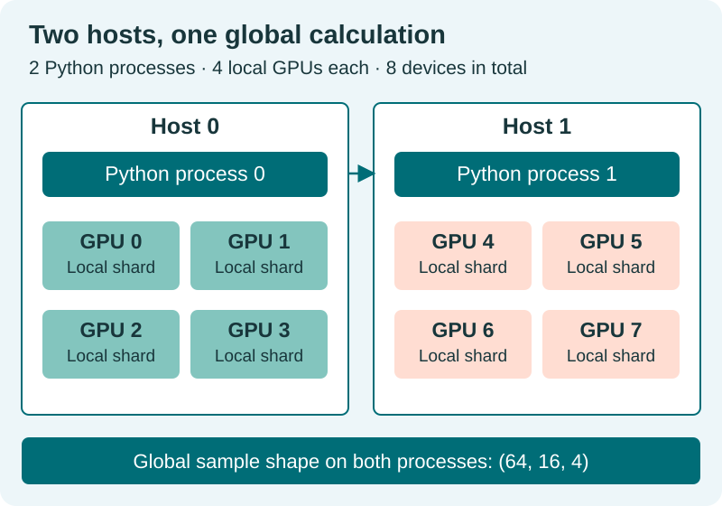
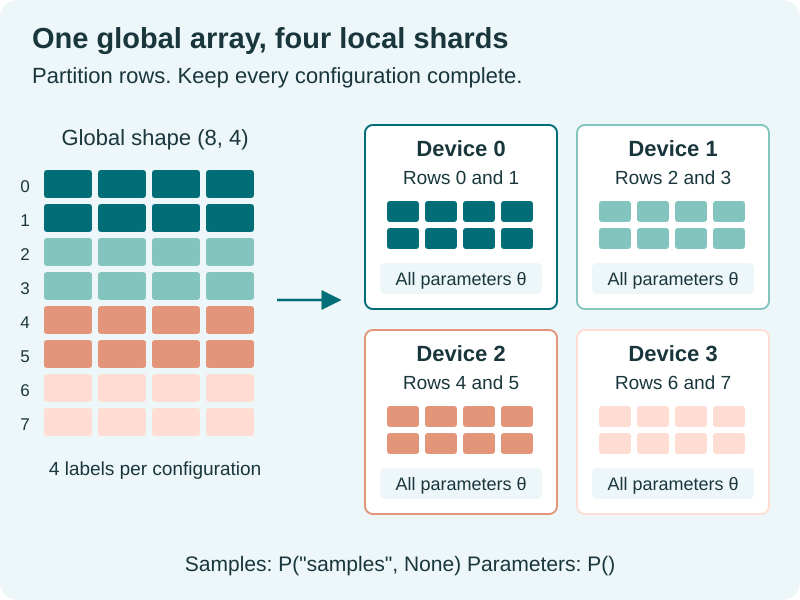
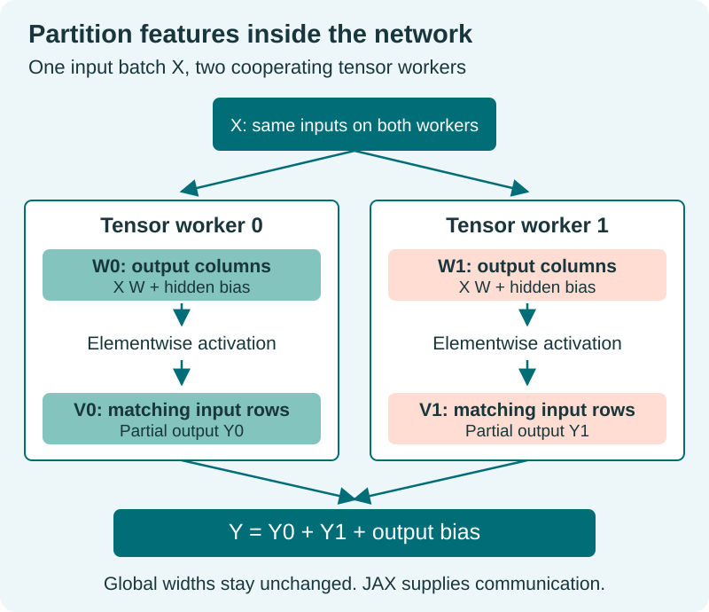

# JAX parallelism

Parallel execution changes where the arrays and numerical work live. A calculation still consists of a graph, a Hilbert space, a wavefunction, a sampler, and an objective. JAX supplies the machinery that places these arrays on devices and communicates between them. neuraLQX uses that machinery to distribute chains and operator terms, partition neural-network contractions, and combine the resulting estimates and gradients.

This page develops the JAX concepts needed to understand those choices. For a fuller explanation of parallelisation, array sharding, and communication between devices, see the [JAX Scaling Cookbook, *How to Scale Your Model*](https://jax-ml.github.io/scaling-book/). Its chapters on [sharded matrices and collective operations](https://jax-ml.github.io/scaling-book/sharding/) and [programming parallel computations in JAX](https://jax-ml.github.io/scaling-book/jax-stuff/) develop the ideas used here. Although its examples focus on large neural networks and TPU systems, the distinction between a global array, its local shards, and the communication needed to combine them also applies to our simulations.

The following page explains [which sharding strategies neuraLQX implements](sharding.md). The hardware guides then carry [one calculation](cpu.md#the-calculation-used-throughout-these-guides) from a CPU to multiple GPU nodes.

## Hosts, processes, and devices

A **host** is a machine on which Python runs. A **process** is one running Python interpreter. A **device** is a numerical execution resource known to JAX, such as a GPU or a CPU device. One process can control several devices. On a cluster, several processes cooperate in the same calculation, with each process controlling its own local devices.

These counts answer different questions. `jax.process_count()` describes how many Python processes joined the calculation. `jax.local_device_count()` counts the devices controlled by the current process. `jax.device_count()` counts all devices in the initialized JAX computation. A workstation with four GPUs can run one process controlling four devices. A two-node job with four GPUs per node can run two processes controlling eight devices in total.



*A possible two-node layout. Device numbers identify positions in the illustration, rather than prescribing how a backend will number them.*

The cluster arrangement needs a startup step, described in [multiple nodes and GPUs](multi-node.md). Merely launching the same script on two machines creates two independent calculations unless the processes join the same distributed runtime. JAX's [multi-controller guide](https://docs.jax.dev/en/latest/multi_process.html) explains the process model in more detail.

## One array can occupy several devices

A JAX array has a global shape and a placement. For example, an array of configurations with shape `(8, 4)` contains eight configurations, each with four labels. We can put the whole array on one device, replicate it on several devices, or split the eight rows among devices. Its global shape remains `(8, 4)` in all three cases.

The piece stored on one device is a **shard**. With four equal partitions of the first dimension, each shard has shape `(2, 4)`. Every shard contains complete configurations. This is different from dividing the four labels of each configuration among devices, which most neuraLQX operator kernels do not support.



*The sample axis is partitioned, while each configuration and each parameter array remain complete on a participating device. The global array is the collection of these shards.*

Replication is an intentional placement. A small parameter array may be needed by every device evaluating a different subset of samples. Replicating it avoids fetching a remote parameter for each model evaluation, but it also means that adding devices does not divide the parameter memory requirement.

## Meshes and partition specifications

A [`Mesh`](https://docs.jax.dev/en/latest/jax.sharding.html#jax.sharding.Mesh) gives names to axes of an array of devices. A one-dimensional mesh might have an axis called `samples` with size four. A three-dimensional mesh might have `samples`, `operators`, and `tensor` each of size two, using eight devices in total. The names describe how we intend to divide work. They are not physical GPU features.

A [`PartitionSpec`](https://docs.jax.dev/en/latest/jax.sharding.html#jax.sharding.PartitionSpec) maps array dimensions to these named mesh axes. `NamedSharding` combines the mesh and the specification.

The JAX documentation also gives a compact introduction to [device meshes and shardings](https://docs.jax.dev/en/latest/the-training-cookbook.html#device-mesh-and-shardings), with examples of how an array's dimensions map onto a device mesh.

| Specification for an array with shape `(batch, width)` | Placement |
| --- | --- |
| `P("samples", None)` | Divide rows over `samples`, keeping each row complete |
| `P(None, "tensor")` | Divide columns between cooperating tensor workers |
| `P()` | Replicate the complete array across the mesh |
| `P("samples", "tensor")` | Divide configurations across sample groups and hidden features within a group |
| `P(("samples", "operators"), None)` | Divide rows across the product of both work axes, retaining complete rows |

An unused mesh axis means replication along that axis. For example, on a mesh containing both `operators` and `samples`, `P("samples", None)` distributes rows over the sample axis and repeats each row shard for all operator partitions. Equal partitions require the divided dimension to be divisible by the corresponding mesh-axis size.

The following complete example uses a single Python process and any number of visible devices. It creates two configurations per device, places a small weight matrix on every device, and evaluates the same matrix operation on the distributed batch.

```python
import jax
import jax.numpy as jnp
import numpy as np
from jax.sharding import Mesh, NamedSharding, PartitionSpec as P

devices = jax.devices()
mesh = Mesh(np.asarray(devices), ("samples",))
host_samples = np.arange(8 * len(devices), dtype=np.float32).reshape(-1, 4)
samples = jax.device_put(host_samples, NamedSharding(mesh, P("samples", None)))
weights = jax.device_put(
    np.full((4, 2), 0.01, dtype=np.float32), NamedSharding(mesh, P())
)

@jax.jit
def evaluate(batch, parameters):
    return jnp.tanh(batch @ parameters)

outputs = evaluate(samples, weights)
outputs.block_until_ready()
print("Global input:", samples.shape)
print("Global output:", outputs.shape)
for shard in samples.addressable_shards:
    print(shard.device, shard.index, shard.data.shape)
np.testing.assert_allclose(
    np.asarray(outputs), np.tanh(host_samples @ np.asarray(weights)), rtol=1e-6
)
```

Save the example to a file and start it with `JAX_PLATFORMS=cpu JAX_NUM_CPU_DEVICES=4 python filename.py` to reproduce four partitions on a CPU. With four devices, the global input is `(8, 4)` and every input shard is `(2, 4)`. The example uses a host NumPy array containing the full input. In a large multi-process calculation, each process should ordinarily construct only the data it can address, as explained in [distributed array handling](multi-node.md#global-arrays-and-process-local-inspection).

## Network contractions across devices

Sample sharding partitions the rows of a feature batch. Tensor parallelism can instead partition the dimensions contracted or produced by a network layer. The mathematical array still has its global shape, even though a device stores only a block.

For a two-layer calculation

$$
Y=\tanh(XW)V,
$$

let $X$ have shape $(8,4)$, $W$ shape $(4,8)$, and $V$ shape $(8,2)$. On two sample groups with two tensor workers each, give each group four rows of $X$, divide the eight output features of $W$ between its workers, and divide the corresponding eight input rows of $V$ the same way. The hidden blocks stay separate through the elementwise activation. Partial products from the last contraction must be combined to recover $Y$.



This complete JAX example fixes the four-device layout and compares the result with the same global NumPy expression. Save it separately and run it with `JAX_PLATFORMS=cpu JAX_NUM_CPU_DEVICES=4 python filename.py`, or on four visible GPUs:

```python
import jax
import jax.numpy as jnp
import numpy as np
from jax.sharding import AxisType, NamedSharding, PartitionSpec as P

assert jax.device_count() == 4
mesh = jax.make_mesh(
    (2, 2), ("samples", "tensor"),
    axis_types=(AxisType.Auto, AxisType.Auto),
)
host_x = np.arange(32, dtype=np.float32).reshape(8, 4) / 32
host_w = np.arange(32, dtype=np.float32).reshape(4, 8) / 64
host_v = np.arange(16, dtype=np.float32).reshape(8, 2) / 32
x = jax.device_put(host_x, NamedSharding(mesh, P("samples", None)))
w = jax.device_put(host_w, NamedSharding(mesh, P(None, "tensor")))
v = jax.device_put(host_v, NamedSharding(mesh, P("tensor", None)))
evaluate = jax.jit(
    lambda batch, first, second: jnp.tanh(batch @ first) @ second,
    out_shardings=NamedSharding(mesh, P("samples", None)),
)
y = evaluate(x, w, v)
np.testing.assert_allclose(
    np.asarray(y), np.tanh(host_x @ host_w) @ host_v, rtol=2e-6, atol=1e-6,
)
for name, array in (("input", x), ("first weight", w), ("second weight", v), ("output", y)):
    print(name, "global shape", array.shape)
    for shard in array.addressable_shards:
        print(" ", shard.device, shard.index, shard.data.shape)
```

A first-weight shard has shape `(4,4)` and repeats across sample groups. An input shard has shape `(4,4)` and repeats across tensor workers. Their equal local shapes do not mean they have the same distribution. Inspecting the indices and specifications identifies which global dimension is split.

The example uses automatic mesh axes and an explicit requested output placement. JAX decides the internal communication required by the global operations. In a neuraLQX calculation, [architecture and layer rules](tensor-parallelism/models.md) select weight specifications, and the framework applies the corresponding constraints during model evaluation. You do not need to insert this standalone JAX program into a VMC driver.

## Compilation, vectorisation, and device parallelism

[`jax.jit`](https://docs.jax.dev/en/latest/_autosummary/jax.jit.html) compiles a numerical function for the input shapes, dtypes, and execution configuration. Compilation does not mean that every available device is automatically useful to the computation. Array placement and the compiled program determine where the work runs.

`jax.vmap` adds a batch dimension to a function. It is useful when expressing the same operation over many configurations, including on one device. A vectorised batch can also be sharded, but vectorisation alone does not select a multi-device placement. Similarly, a Python loop over devices is not what makes the example above parallel. JAX evaluates the global array operation using its device placement.

JAX supports several levels of control. In automatic sharding mode, the compiler propagates placements and chooses internal layouts around constraints. In explicit sharding mode, sharding information is part of traced array types, and ambiguous operations may require an output annotation. Both use global array operations. With [`jax.shard_map`](https://docs.jax.dev/en/latest/_autosummary/jax.shard_map.html), the function instead sees a local block, and the author specifies communication when it is needed. The [JAX parallelism guide](https://docs.jax.dev/en/latest/parallel.html) develops these modes and how they compose.

neuraLQX combines these levels of control. Its sampler and term dispatcher can manually partition independent work while leaving the tensor axis automatic. Inside that computation, the network still sees complete global feature dimensions. JAX partitions the network contractions and their derivatives. A user of the standard VQS and driver interfaces does not need to write the mapped kernels or manual tensor collectives.

## Communication preserves the global calculation

Suppose device $d$ owns $n_d$ local estimator values, with local sum $s_d$. The overall mean is

$$
\overline A=\frac{\sum_d s_d}{\sum_d n_d}.
$$

If all $n_d$ are equal, averaging device means gives the same result. If the counts differ, an unweighted mean of device means is wrong. This is why global shapes, valid sample counts, and reduction semantics matter as much as distributing the expensive model evaluations.

A **collective** is an operation in which devices exchange information. A sum reduction combines contributions, an all-gather assembles pieces, and a redistribution moves an array between layouts. For sample parallel VMC, local model evaluations can proceed independently, while expectations and parameter gradients need global information. For operator parallel evaluation, contributions from different terms must be combined for each sample. For tensor parallel evaluation, partial contractions inside the network must be combined, potentially several times during one forward and backward pass. Copies of one input across tensor workers remain one statistical observation.

More devices can therefore reduce local work while introducing communication and additional compilation. The useful balance depends on the network size, number of samples, operator connectivity, and device interconnect. A small example may run faster on one device. Use the [profiling guides](../developers/profiling/for-scientists.md) to determine what dominates a real calculation.

## Global shape and addressable shards

`array.shape` describes the whole array. `array.addressable_shards` lists only the shards controlled by the current process. On a single host process these may include the entire array. Across hosts, some shards belong to another process and cannot be read directly as local NumPy data.

The standard simulation prints each addressable shard's index and shape without gathering its contents. This is a practical first check of placement. All processes must still execute collective numerical operations in the same order. Restrict ordinary printing to process zero when useful, but do not put a collective expectation or checkpoint inside that condition. The [multiple-node guide](multi-node.md#collective-control-flow-and-output) shows the distinction.

Continue with [sharding in neuraLQX](sharding.md) for the library's supported layouts, or with [CPU installation and the shared simulation](cpu.md) to start running the example.
