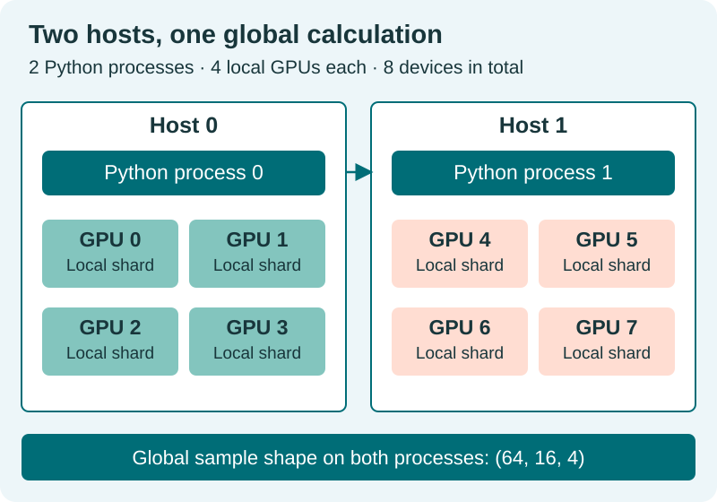
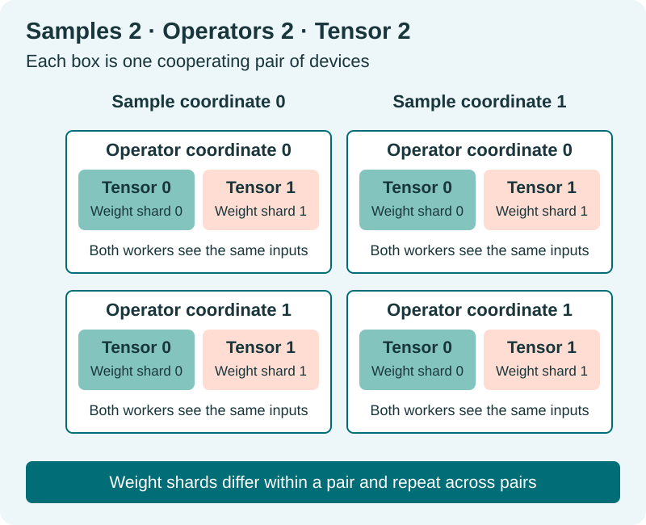

# Multiple nodes and GPUs

## Installation and environment

Every node needs an environment with the same neuraLQX version, JAX and accelerator packages, and compatible drivers. Prepare that environment on a shared filesystem or reproduce it on each node. For the Linux NVIDIA setup used here:

```bash
python -m pip install --upgrade "neuralqx[cuda]"
python -m pip check
python -m pip freeze > requirements-run.txt
```

Use an explicit `jax[cuda12]` or `jax[cuda13]` installation when your site requires a particular CUDA family, as explained in [single GPU installation](single-gpu.md#installation-and-environment). A shared virtual environment is suitable only when the nodes have compatible operating systems and architectures and can access its interpreter and libraries. Follow your site's module or container workflow where that is required.

The numerical backend also needs working communication between the allocated nodes. For NVIDIA devices this includes NCCL and the network stack appropriate to the cluster. Follow the cluster's supported JAX environment for interconnect-specific modules and library paths. A successful one-node run does not establish that the multi-node transport is configured.

Keep the [simulation.py](examples/simulation.py) from the previous guides. This page changes how the processes are launched and joined. It does not change the physical calculation or divide the Python source into a coordinator script and a different worker simulation.

## Join the processes before using JAX devices

For two nodes with four GPUs each, we will run one Python process per node. Both processes execute the same program and join the same JAX runtime. Each sees four local devices and eight global devices.



Enable neuraLQX's automatic distributed initialization with `NEURALQX_DISTRIBUTED=1` **before importing neuraLQX**. Its configuration hook calls [`jax.distributed.initialize`](https://docs.jax.dev/en/latest/_autosummary/jax.distributed.initialize.html) before the package starts creating device arrays. Leave `NEURALQX_DISTRIBUTED_AUTO_INITIALIZE=1`, which is the default, for this route.

All processes must agree on the coordinator address and process count. Each needs a unique process ID in the range `0` through `num_processes - 1`. The coordinator address is a reachable address of process zero and an available port. `localhost` would refer to a different machine on each node and is unsuitable for this launch.

Do not call `jax.devices()`, construct a JAX array, or initialise a model before joining the runtime. The common script imports JAX without querying devices, imports neuraLQX, and only then prints device information. The environment must be in place before that script starts.

JAX can infer initialization arguments in supported launch environments. However, its Slurm GPU discovery can default to one device per process. The jobs below supply the topology explicitly so that one process per node controls all four allocated GPUs. The [configuration reference](configuration.md#distributed-runtime) lists each argument and its environment name.

## A two-node Slurm job

Save [multi-node.sh](examples/multi-node.sh), [run-slurm-worker.sh](examples/run-slurm-worker.sh), and [simulation.py](examples/simulation.py) in the submission directory. Prepare `.venv` there and make the directory visible at the same path on both nodes. Adjust the account, partition, resource limits, and coordinator port to your site.

The batch script requests the resources and sets values shared by all processes:

```bash
#!/usr/bin/env bash
#SBATCH --job-name=nqx-nodes
#SBATCH --nodes=2
#SBATCH --ntasks=2
#SBATCH --ntasks-per-node=1
#SBATCH --gpus-per-node=4
#SBATCH --cpus-per-task=8
#SBATCH --mem=32G
#SBATCH --time=00:20:00
#SBATCH --output=nqx-nodes-%j.out

set -euo pipefail
cd "${SLURM_SUBMIT_DIR}"
source .venv/bin/activate
export JAX_PLATFORMS=cuda
export NEURALQX_SHARDING=samples
export NEURALQX_DISTRIBUTED=1
export NEURALQX_DISTRIBUTED_AUTO_INITIALIZE=1
export NEURALQX_DISTRIBUTED_NUM_PROCESSES="${SLURM_NTASKS}"
export NEURALQX_DISTRIBUTED_LOCAL_DEVICE_IDS=0,1,2,3
nqx_coordinator_host=$(scontrol show hostnames "${SLURM_JOB_NODELIST}" | head -n 1)
export NEURALQX_DISTRIBUTED_COORDINATOR_ADDRESS="${nqx_coordinator_host}:12355"
srun --kill-on-bad-exit=1 bash run-slurm-worker.sh
```

The small worker script runs inside each Slurm task and sets that task's global process ID:

```bash
#!/usr/bin/env bash
set -euo pipefail

# This runs inside each Slurm task, where the global task ID is defined.
export NEURALQX_DISTRIBUTED_PROCESS_ID="${SLURM_PROCID}"
exec python -u simulation.py "$@"
```

Submit with `sbatch multi-node.sh`. The `srun` command launches both Python processes. The process count is **two**, not eight, because there is one Python interpreter per node. `NEURALQX_DISTRIBUTED_LOCAL_DEVICE_IDS=0,1,2,3` selects the four device ordinals visible inside each task's allocation. These are local ordinals after scheduler visibility has been applied.

The coordinator hostname is taken from the first allocated node. Port `12355` is an example and must be available and reachable inside the allocation. All processes must use the same value. The [Slurm `sbatch`](https://slurm.schedmd.com/sbatch.html) and [`srun`](https://slurm.schedmd.com/srun.html) references explain the difference between allocating resources and starting tasks. The scripts leave device visibility to Slurm and do not assume that the physical GPU numbers are the same on different hosts.

## What changes in the arrays

With the default sample policy, the global sample shape remains `(64, 16, 4)`. Eight devices share the 64 chains, so each device owns `(8, 16, 4)`. Each process can address four of those shards, corresponding to 32 chains and 512 retained configurations. Those are local holdings, not separate requests for 1,024 samples on each process.

The model initialization and sampler seeds remain identical in both processes. The framework distributes the sampler's random streams across sample partitions. Each process then participates in the same expectation and gradient calculation and applies the same optimisation step. Do not independently initialise different networks or use process-dependent hyperparameters.

To enable operator work distribution, change the batch job to `NEURALQX_SHARDING=samples,operators`. For the example's four terms on eight devices, sampling uses eight sample partitions, while operator evaluation uses four operator partitions and two sample partitions. The [phase-layout figure](sharding.md#combined-operator-and-sample-layouts) shows why the data distribution changes between these phases.

Cross-node communication is usually more expensive than communication within one host. Operator sharding can replicate sample data across term partitions, and global gradients also require communication. Measure a representative calculation before scaling a job simply because more devices are available.

## Tensor groups across the allocation

Distributed initialization establishes the global device set. Tensor parallelism then partitions that set using the same policies as a single host. It does not require a separate tensor process launcher.

Download [multi-node-tensor.sh](examples/multi-node-tensor.sh) for the complete two-node variant. It retains the two-process launch, coordinator, and four local GPU IDs from the preceding job, and selects:

```bash
export NEURALQX_SHARDING=samples,operators,tensor
export NEURALQX_MESH_SAMPLE_AXIS_SIZE=2
export NEURALQX_MESH_OPERATOR_AXIS_SIZE=2
export NEURALQX_MESH_TENSOR_AXIS_SIZE=2
```

Submit with `sbatch multi-node-tensor.sh` beside the same worker and simulation files. Across eight GPUs, the resolved mesh is `(2,2,2)`. Sampling uses four independent groups of 16 chains. Every tensor pair contains two copies of its group's `(16,16,4)` sample shard and complementary weight shards. Operator evaluation assigns two terms and 512 configurations to each sample/operator coordinate.



The mesh constructor uses JAX's topology-aware device ordering. Do not assume a tensor group stays inside a host solely because its size is smaller than the host's GPU count. Inspect the actual mapping inside the initialized job:

```python
import jax
import neuralqx as nqx
from neuralqx.jax.tensor_parallel import tensor_mesh

assert nqx.config.network_sharding_enabled
mesh = tensor_mesh()
if jax.process_index() == 0:
    print("Mesh:", dict(mesh.shape))
    for sample in range(mesh.devices.shape[0]):
        for operator in range(mesh.devices.shape[1]):
            members = mesh.devices[sample, operator, :]
            print(
                "Sample", sample, "operator", operator,
                [(device.process_index, device.id) for device in members],
            )
```

The pair `(process_index, device.id)` identifies where each worker is controlled. This diagnostic uses device metadata and does not gather remote numerical buffers. A tensor group can span processes. When it does, the network's collectives cross that process boundary as well.

Tensor communication occurs within layer contractions and their derivatives, so interconnect behavior can matter at a finer scale than a single reduction per optimization step. Favor a layout appropriate to the physical topology, verify its actual mapping, and profile representative model sizes. There is no guarantee that using every enabled mode at once gives the shortest step time.

The other policies remain available. On eight GPUs, `samples,tensor` with tensor size four gives two independent groups of four cooperating workers. Tensor-only execution uses all eight workers for the same model evaluation. Keep widths divisible by the chosen tensor size and use [direct distributed initialization](tensor-parallelism/models.md#initialize-directly-into-shards) if a full model cannot be initialized on one device.

## One process per GPU

Some sites prefer one scheduler task for each GPU. The same Python script can use that arrangement, but the process count and local-device settings change. For two nodes with four GPUs each, request eight tasks in total, four tasks per node, and one GPU per task. Set `NEURALQX_DISTRIBUTED_NUM_PROCESSES=8` and `NEURALQX_DISTRIBUTED_LOCAL_DEVICE_IDS=0` when Slurm makes only the assigned GPU visible to each task.

Download [multi-node-one-gpu.sh](examples/multi-node-one-gpu.sh) for a complete alternative job that reuses the same worker script. In that job, each process sees one local device and eight global devices. Do not copy a physical GPU number into `local_device_ids` after the scheduler has reduced the visible devices to a single logical GPU.

| Layout for two nodes with four GPUs each | Python processes | Local devices per process | Global devices |
| --- | --- | --- | --- |
| One process per node | 2 | 4 | 8 |
| One process per GPU | 8 | 1 | 8 |

Choose one layout consistently. Running two processes that both claim all four GPUs on a host is a different allocation and can cause competing runtimes and memory exhaustion.

## Explicit launch without Slurm

For a manually managed allocation, start the same command on every node with the appropriate process ID. For example, if the first host is reachable as `compute-01`, use the following on that host:

```bash
JAX_PLATFORMS=cuda \
NEURALQX_DISTRIBUTED=1 \
NEURALQX_DISTRIBUTED_COORDINATOR_ADDRESS=compute-01:12355 \
NEURALQX_DISTRIBUTED_NUM_PROCESSES=2 \
NEURALQX_DISTRIBUTED_PROCESS_ID=0 \
NEURALQX_DISTRIBUTED_LOCAL_DEVICE_IDS=0,1,2,3 \
python simulation.py
```

Start the same command on the second host with `NEURALQX_DISTRIBUTED_PROCESS_ID=1`, retaining the coordinator address of the first host. Replace `compute-01` with the allocated host's actual reachable name. Both environments must expose the intended four GPUs and contain the same simulation file. The first command waits for the other process to join. Neither neuraLQX nor JAX starts the remote Python process for you.

If an existing application already calls `jax.distributed.initialize()` itself, do so before importing neuraLQX and set `NEURALQX_DISTRIBUTED_AUTO_INITIALIZE=0` before starting Python. Use the [JAX multi-controller documentation](https://docs.jax.dev/en/latest/multi_process.html) for that initialization route. Avoid mixing manual and automatic startup halfway through a running session.

## Global arrays and process-local inspection

Each process can inspect the global shape and sharding, but it does not own all global buffers. The example prints `state.samples.addressable_shards` so that each process reports only its own device indices and local shapes. Converting the entire distributed sample array with `np.asarray(state.samples)` is not a way to obtain all remote shards. Tensor replication also means several local shards can describe the same global sample indices. Do not concatenate or count every addressable shard as an independent batch.

In code that constructs arrays from external data, use JAX's [distributed data-loading guidance](https://docs.jax.dev/en/latest/distributed_data_loading.html), including `jax.make_array_from_process_local_data` or callback-based construction where appropriate. Standard neuraLQX sampling already constructs its sample layout. You do not need to gather the chains onto process zero between VMC steps.

## Collective control flow and output

All processes must execute the same collective numerical operations in the same order. In the common script, `state.expect(objective)` and `jax.device_get(result.mean)` run on every process. Only the final ordinary `print` is restricted to process zero. Putting the expectation itself inside `if jax.process_index() == 0` can leave other processes waiting for communication that never occurs.

The same rule applies to [state saving and loading](../concepts/vqs/saving.md). Distributed checkpoint calls participate on every process and use a shared writable destination. A process-zero condition is suitable for an ordinary scalar text report after the relevant value is available, not for wrapping a collective checkpoint. The [callback control guide](../concepts/callbacks/control.md) discusses coordinated stopping and saving.

When diagnosing a stalled job, keep per-process startup output. Check that every process reports the expected global count and a disjoint local device set. The [troubleshooting page](troubleshooting.md#initialization-waits-or-times-out) develops that check and covers initialization timeouts, incompatible placements, and memory problems.
