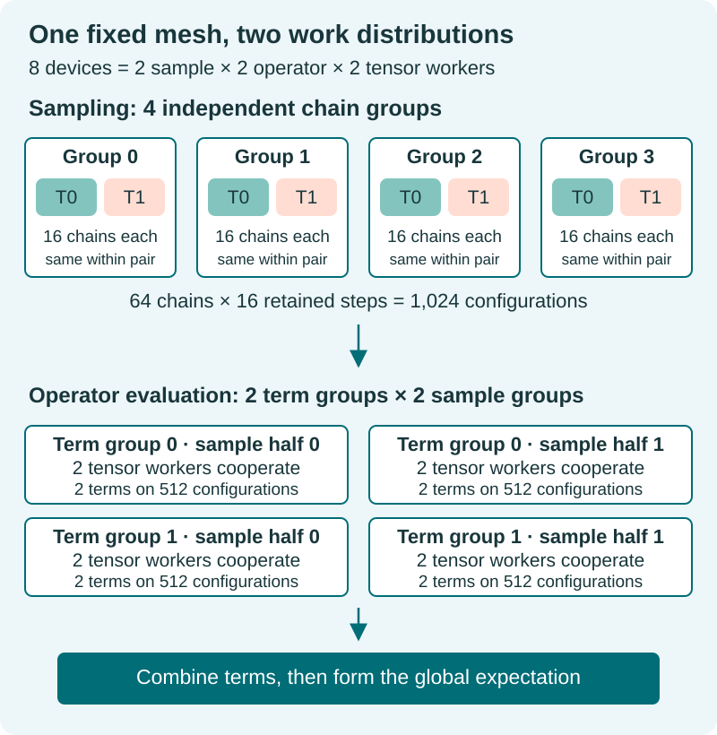
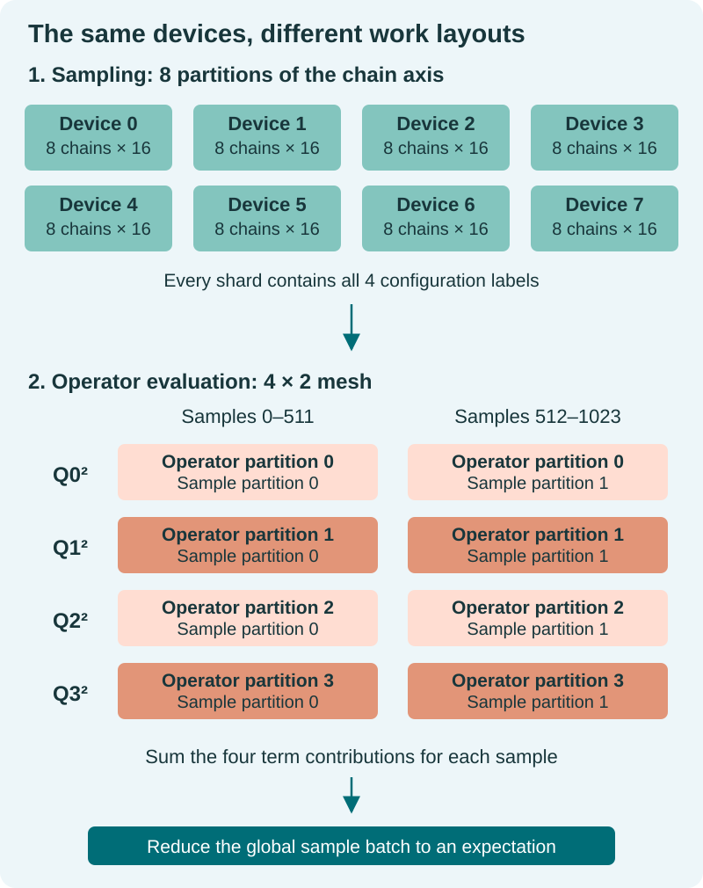

# Sharding in neuraLQX

neuraLQX can distribute three different parts of a variational calculation. **Sample parallelism** assigns different configurations to independent workers. **Operator parallelism** assigns independent terms to different workers. **Tensor parallelism** makes several devices cooperate inside one network evaluation by partitioning its weights and contractions.

The [JAX parallelism page](jax-parallelism.md) introduces meshes and global arrays. This page connects those concepts to sampling and estimation. The [tensor parallelism section](tensor-parallelism/index.md) develops network partitioning in detail, and the hardware guides carry [one shared simulation](cpu.md#the-calculation-used-throughout-these-guides) through these choices.

| Execution axis | Work that differs across the axis | Information shared across the axis |
| --- | --- | --- |
| `samples` | Configurations or Markov chains | The same model weights |
| `operators` | Scheduled operator terms during local-estimator evaluation | Configurations needed to combine those terms and the same model weights |
| `tensor` | Portions of network tensors and contractions | The same configurations and the global model definition |

An operator axis can also carry independent chains during sampling when sample sharding is enabled. The work assigned to an axis can therefore depend on the execution phase, while a tensor group continues to cooperate on each model evaluation.

## Samples and chains

Sample sharding is enabled by default. For the supplied Metropolis samplers, it divides the leading chain dimension while retaining each complete configuration and the time history within a chain. With a sample array of shape $(C,L,N)$, $C$ is the global chain count, $L$ is the retained chain length, and $N$ is the Hilbert space configuration width.

Without tensor parallelism, the standard sample policy uses all $D$ devices as independent chain partitions. Each device holds $(C/D,L,N)$ when the chain count divides evenly. With tensor parallelism, cooperating workers receive the **same** chain data. On a mesh of sizes $(D_S,D_O,D_T)$, enabled sample sharding uses $D_S D_O$ independent groups, and each tensor worker holds

$$
\left(\frac{C}{D_S D_O},L,N\right).
$$

The total number of retained observations is always $CL$. Tensor replication does not increase this number. With sample sharding disabled, each group receives the complete chain batch instead.

For the [shared example](cpu.md), $C=64$, $L=16$, and $N=4$:

| Eight-device policy | Independent chain groups | Sample shard on each device | Replication of each chain shard |
| --- | --- | --- | --- |
| `samples` | 8 | `(8, 16, 4)` | None |
| `samples,tensor` with tensor size 2 | 4 | `(16, 16, 4)` | Two tensor workers |
| `samples,operators,tensor` with mesh `(2,2,2)` | 4 | `(16, 16, 4)` | Two tensor workers |
| `tensor` with tensor size 8 | 1 | `(64, 16, 4)` | Eight tensor workers |

The sampler rounds a requested `n_chains` upward to divisibility by its independent sampling-group count. The sample request is then adjusted to the nearest positive multiple of the resolved chain count, choosing the larger value on a tie. Inspect the resolved shape rather than assuming an arbitrary request was used unchanged.

The sampler property [`sample_device_count`](../api/public/neuralqx/sampler/base/index.md#neuralqx.sampler.base.AbstractSampler.sample_device_count) reports this independent count. In tensor mode, `n_chains_per_device` refers to chains per independent group, excluding the cooperating tensor workers. The [scaling example](multi-gpu.md#fixed-work-and-growing-work) uses that property when deliberately growing the statistical workload.

All processes in a coordinated calculation should use the same initial model and sampler seeds. The sampler constructs the distributed random streams. Do not independently add a process ID to the model seed. Record the topology with the seeds, since changed layouts and floating-point reductions need not produce bitwise-identical trajectories.

## Operator terms

For a sum $H=\sum_t c_t O_t$, the local estimator is

$$
H_{\mathrm{loc}}(\sigma)
=\sum_t c_t\sum_{\sigma'}
(O_t)_{\sigma,\sigma'}
\frac{\psi(\sigma')}{\psi(\sigma)}.
$$

The terms can be evaluated independently before their contributions are summed. Operator sharding distributes this term work. For supported [`ComputationalOperator`](../api/public/neuralqx/operator/index.md#neuralqx.operator.ComputationalOperator) terms, the device dispatch generates each assigned term's connections and evaluates its connected configurations within the assigned device or tensor group. The operators remain [matrix free](../concepts/operators/index.md#matrix-free-by-design).

Enable this policy before importing neuraLQX:

```bash
NEURALQX_SHARDING=samples,operators JAX_PLATFORMS=cuda python simulation.py
```

The expectation machinery flattens linear sums and operator sequences into terms. A graph edge is not automatically a separately scheduled term, and splitting a sum across devices does not divide every individual operator's connection dimension. The decomposition exposed by the [operator algebra](../concepts/operators/algebra.md) determines what can be scheduled.

The default planner estimates term cost from `max_conn_size`, assigns terms to balance those estimates, and pads the schedule with zero-work slots if necessary. This is a heuristic, not a measurement of each term's actual runtime. Different connection patterns and network evaluations can still produce imbalance. Non-computational or specialised estimator paths can use a fallback rather than the computational term-dispatch path.

## Combined operator and sample layouts

The treatment of execution phases depends on whether a tensor mesh is active.

### With tensor parallelism

The sample/operator/tensor mesh remains fixed across phases. Sampling and gradient-force evaluation can distribute configurations over both outer work axes, while the innermost tensor workers cooperate on the same inputs. Operator evaluation uses its operator coordinate to choose terms and its sample coordinate to divide the batch.



*Eight devices, four operator terms, and 1,024 configurations. A box denotes a pair of tensor workers. The pair survives redistribution of the sample batch.*

For the `(2,2,2)` mesh, sampling divides 64 chains into four groups of 16. Local-estimator evaluation instead assigns 512 flattened configurations to each sample partition and two operator terms to each operator partition. The operator contributions are combined for each configuration, then the statistical calculation reduces over configurations. Both tensor workers inside a pair participate in its model contractions.

The operator planner uses the configured operator-axis size rather than rebuilding it from the term count. If that size is one, there is no cross-group operator dispatch. If it exceeds the term count, the scheduler can include idle slots. If a supplied flattened batch cannot divide the configured sample-axis size, the operator plan can retain a replicated batch instead of using that axis. Inspect actual placements for externally supplied batches.

### Without tensor parallelism

Sampling uses the device set as sample partitions. Operator evaluation chooses a separate phase layout from the workload. For $K$ computational terms on $D>1$ devices, the default planner uses all devices as operator partitions when $K\ge D$. With fewer terms and sample sharding enabled, it seeks $D=D_O D_S$ with $D_O\le K$, $D_S>1$, and sample count divisible by $D_S$, choosing the largest eligible $D_O$. If no such factorization exists, it uses an operator-only layout with padding.

For the shared four-term example, four devices become four operator partitions with the full batch available to each. Eight devices become four operator partitions and two sample partitions. Sampling on those same eight devices still uses eight independent chain groups.



The tensor and non-tensor paths therefore have different mesh policies. The [configuration guide](configuration.md#mesh-names-and-sizes) explains when explicit size controls fix the execution mesh and when a planner makes a workload-dependent choice.

## Inspect and compare operator execution

Save [simulation.py](examples/simulation.py) in the current directory before running this example. It creates one sample batch and evaluates that same batch with operator sharding disabled and enabled. Keeping the samples fixed separates execution differences from Monte Carlo fluctuations.

```python
import jax
import numpy as np
from simulation import build_calculation

state, objective, _ = build_calculation()
samples = state.samples
ordinary = state.local_estimators(
    objective, samples=samples, operator_sharding=False
)
distributed = state.local_estimators(
    objective, samples=samples, operator_sharding=True
)
np.testing.assert_allclose(
    jax.device_get(ordinary.data),
    jax.device_get(distributed.data),
    rtol=1e-12,
    atol=1e-12,
)
print(distributed.to_stats().mean)
```

Use a single process with multiple visible devices for this comparison. Four logical CPU devices are sufficient to exercise the operator dispatch. A one-device run remains valid but cannot demonstrate cross-device scheduling. The tight tolerance here is appropriate for the example's diagonal integer-valued objective, not a universal tolerance for arbitrary operators.

The per-call `operator_sharding` option is accepted by [`local_estimators`](../api/public/neuralqx/vqs/estimators/index.md#neuralqx.vqs.estimators.local_estimators). It can request the computational operator path independently of the global default. A full VMC run uses the configuration because the driver calls the state without a per-call override. Related options can be grouped in [`LocalEstimatorOptions`](../api/public/neuralqx/vqs/estimators/index.md#neuralqx.vqs.estimators.LocalEstimatorOptions).

## Network tensors

Tensor parallelism is enabled with the `tensor` policy axis or the `network_sharding_enabled` flag. It partitions eligible trainable arrays and their contractions within a cooperating group. The [tensor overview](tensor-parallelism/index.md) derives the dense-layer decomposition and explains its communication.

Model weight shards are replicated over the sample and operator coordinates. A weight array with `P(None, "tensor")` is divided along its second dimension inside each group. A weight with `P()` is complete on every worker. Fixed model collections use replicated placement in the tensor adapter.

The [built-in models](tensor-parallelism/models.md) provide architecture rules. You can also [compose supplied layers or define explicit rules](tensor-parallelism/custom-models.md) for your own network. Use direct sharded initialization when a full copy would not fit on one device. Pipeline parallelism is not part of the execution interface.

## Chunking and streaming

Sharding divides work between devices. Chunking processes smaller pieces sequentially within an evaluation. They can be used together, but they address different limits.

`VariationalState.chunk_size` limits model evaluation batches. Operator streaming limits how many flattened input configurations are passed through connection generation at once. Its setting is `operator_streaming_chunk_size`, with a default of 1,024 when streaming is enabled. It is a count of input configurations, not operator terms or connected outputs.

For example, in a fresh run:

```bash
NEURALQX_OPERATOR_STREAMING_ENABLED=1 \
NEURALQX_OPERATOR_STREAMING_CHUNK_SIZE=64 \
JAX_PLATFORMS=cuda python simulation.py
```

This preserves the example's global sample count and sharding policy. It changes the size of connection-generation chunks. Streaming can reduce temporary workspace, but paths that assemble padded outputs still need storage for those outputs. Likewise, neither model chunking nor operator streaming removes the need to store the network parameters. See [batching and chunking](../concepts/vqs/batching.md) and [memory troubleshooting](troubleshooting.md#out-of-memory-errors) when choosing which allocation to reduce.

Proceed to the [CPU guide](cpu.md) for the complete simulation, or inspect the [parallelism configuration](configuration.md) for the supported launch and layout controls.
