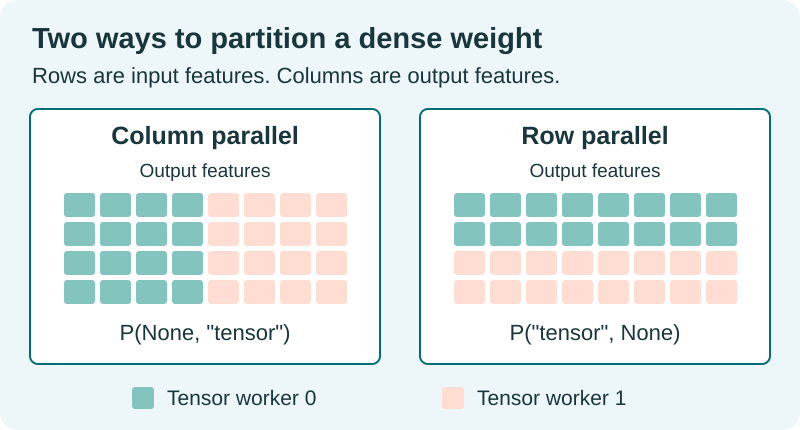
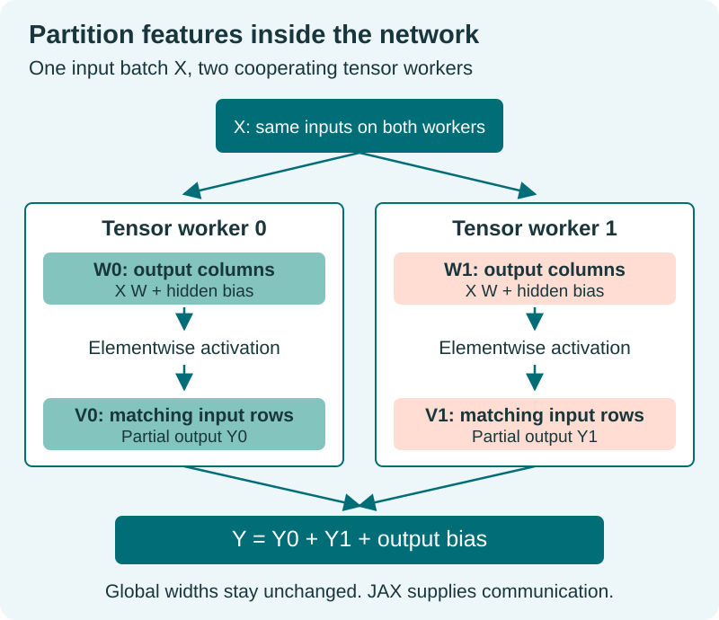
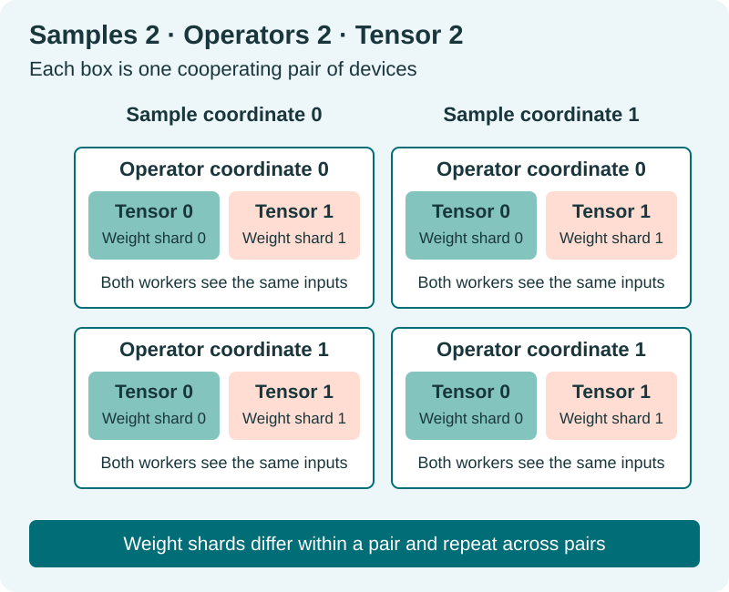

# Tensor parallelism

Tensor parallelism divides the arrays and contractions inside a neural network between cooperating devices. Those devices evaluate **one wavefunction on the same configurations**. Each holds a portion of selected weights and performs the corresponding part of the calculation. This allows a large hidden layer to use the memory and computation of several devices while preserving the model's global dimensions.

neuraLQX uses **one-dimensional tensor parallelism**, combining column and row partitions according to fixed architecture rules. Only the `tensor` mesh axis partitions the weights. The other axes distribute independent work and replicate those weight shards between groups.

This differs from [sample sharding](../sharding.md#samples-and-chains), where devices evaluate complete models on different configurations. Both are useful, and neuraLQX can combine them with [operator sharding](../sharding.md#operator-terms). The three execution axes are named `samples`, `operators`, and `tensor`. Pipeline parallelism, which assigns successive network stages to different devices, is not implemented in this release.

## Start with an existing simulation

Use the [shared simulation](../cpu.md#the-calculation-used-throughout-these-guides) from the hardware guides. On a host with four visible GPUs, this launch creates two independent sampling groups, each containing two cooperating tensor workers:

```bash
NEURALQX_SHARDING=samples,tensor \
NEURALQX_MESH_TENSOR_AXIS_SIZE=2 \
JAX_PLATFORMS=cuda python simulation.py
```

The [built-in MLP](../../concepts/networks/built-in/mlp.md) already has tensor partition rules. The variational state selects them when `network_sharding_enabled` is true. The simulation uses [`init_tensor_parallel`](../../api/public/neuralqx/nn/index.md#neuralqx.nn.init_tensor_parallel) so that initialization also writes directly into the intended shards.

To exercise the same placement on a CPU, replace `JAX_PLATFORMS=cuda` with `JAX_PLATFORMS=cpu JAX_NUM_CPU_DEVICES=4`. Logical CPU devices are useful for correctness and layout checks. They do not reproduce GPU communication performance.

Selecting `NEURALQX_SHARDING=tensor` instead uses one tensor group across the available devices, with no independent sample or operator partitions. On four devices its tensor size must be four, or left unset so it can be inferred. To use two tensor workers per group on those four devices, enable another work axis to use the remaining factor of two.

## Splitting a dense layer

Consider a batch of features $X\in\mathbb R^{B\times F}$ and a dense layer

$$
Z=XW+b,
\qquad W\in\mathbb R^{F\times H}.
$$

Here $B$ counts configurations, $F$ is the input width, and $H$ is the hidden width. The names **column parallel** and **row parallel** refer to Flax's weight ordering `(input_features, output_features)`:

| Layout | Weight specification | Work assigned to one tensor worker |
| --- | --- | --- |
| Column parallel | `P(None, "tensor")` | Compute a block of output features |
| Row parallel | `P("tensor", None)` | Compute a partial output using a block of input features |



With $D_T$ tensor workers, a column partition divides $W$ into blocks $W^{(t)}\in\mathbb R^{F\times H/D_T}$. Worker $t$ computes

$$
Z^{(t)}=XW^{(t)}+b^{(t)}.
$$

Each worker needs the same $X$, but owns different hidden features. An elementwise activation can act directly on that block, giving $A^{(t)}=\phi(Z^{(t)})$. No operation across the hidden feature dimension is needed for this activation.

Now let the next layer have $V\in\mathbb R^{H\times K}$. Divide its **input rows** to match the hidden blocks. The complete result is

$$
Y=\sum_{t=0}^{D_T-1}A^{(t)}V^{(t)}+c.
$$

This row-partitioned layer consumes the column-partitioned layer's hidden blocks. With an elementwise activation between them, the mathematical decomposition does not require gathering the complete hidden activation first. The sum combines partial contractions. The output bias $c$ belongs to the complete output and is added once in the global expression. It must not be independently counted $D_T$ times.



*An output-partitioned projection followed by an input-partitioned projection. This is the pairing used by the built-in MLP where the dimensions permit it.*

For JAX weight arrays the corresponding specifications are `P(None, "tensor")` for $W$ and `P("tensor", None)` for $V$. The Python model continues to write ordinary global matrix products. neuraLQX constrains the weight layouts, and JAX compiles the contractions and required communication. The exact collective sequence is a compiler decision, so the diagram describes the mathematical decomposition rather than a promised instruction trace.

The same reasoning applies to complex weights. Partitioning neither makes a model holomorphic nor changes its derivative convention. Those choices still follow the [complex network](../../concepts/networks/complex.md) and [variational gradient](../../concepts/vqs/expectations.md#the-gradient-of-a-hermitian-expectation) interfaces.

## Combine independent work with tensor groups

Write the global device count as

$$
D=D_S D_O D_T.
$$

The sample and operator axes have sizes $D_S$ and $D_O$. Every pair of their coordinates identifies a group of $D_T$ tensor workers. Model weight shards repeat across the independent work axes. Inside each group, different tensor coordinates hold different portions of the same weights.

For example, eight devices can form a `(samples=2, operators=2, tensor=2)` mesh:

```bash
NEURALQX_SHARDING=samples,operators,tensor \
NEURALQX_MESH_SAMPLE_AXIS_SIZE=2 \
NEURALQX_MESH_OPERATOR_AXIS_SIZE=2 \
NEURALQX_MESH_TENSOR_AXIS_SIZE=2 \
JAX_PLATFORMS=cuda python simulation.py
```



During sampling, both outer axes can hold independent chains when sample sharding is enabled. The 64 chains therefore divide among four groups, with 16 chains per group. The two tensor workers in a group see the same `(16, 16, 4)` sample shard. They do not produce twice as many observations.

During operator evaluation, the operator coordinate selects assigned terms, and the sample coordinate partitions the flattened batch. For the four-term example, each of the two operator partitions evaluates two terms on 512 configurations. Each such evaluation still uses two tensor workers. The [phase-layout guide](../sharding.md#combined-operator-and-sample-layouts) explains the redistribution between these stages.

With `operators,tensor`, sample sharding is disabled. Chains are replicated, operator groups evaluate distinct terms, and each term evaluation uses its tensor group. With `samples,tensor`, the operator axis has size one and both outer groups process different chains. Use the [configuration table](../configuration.md#sharding-policy) to select these combinations explicitly.

## What memory is reduced

Suppose a model has $N_{\rm split}$ scalar weights in partitioned arrays and $N_{\rm repl}$ in replicated arrays, all using $b$ bytes per scalar. Ignoring allocator and temporary-buffer overhead, weight storage on one device is

$$
M_{\rm weights}
=b\left(\frac{N_{\rm split}}{D_T}+N_{\rm repl}\right).
$$

This is a weight-storage estimate, not a peak-memory estimate for a VMC step. Activations, optimizer state, connected configurations, fixed model collections, and differentiation intermediates also occupy memory. Some hidden activations can remain partitioned, while other operations require communication or replication. Small output heads and biases may deliberately remain replicated.

Adding sample or operator groups creates additional copies of the distributed model. It does not further divide each weight shard. Conversely, increasing $D_T$ at fixed $D$ leaves fewer groups for independent samples or terms. Use tensor parallelism when the model's memory or contraction cost warrants that tradeoff. The small demonstration mainly establishes behavior and should not be used as a scaling benchmark.

## Expectations and gradients retain their meaning

Tensor partitioning represents the same global log wavefunction $\ell_\theta(x)$. It does not introduce a new sampling distribution, alter `machine_pow`, or change importance weights. For ordinary Born sampling, a local estimator remains

$$
A_{\rm loc}(x)
=\sum_y A_{xy}\exp\!\left(\ell_\theta(y)-\ell_\theta(x)\right).
$$

Tensor workers cooperate on the log-wavefunction evaluations in this expression. Operator groups may divide the outer operator sum, and sample groups provide different configurations for the statistical mean. Repeated sample buffers along a tensor axis are copies of the same observations and must not be counted as independent draws.

The framework uses ordinary JAX differentiation through the global model. Communication associated with partitioned contractions is included in that differentiated computation. This does not add a user-visible factor of $D_T$ to the loss, gradient, learning rate, or normalization. Keep the same scientific settings when comparing execution policies.

For [importance sampling](../../concepts/samplers/importance.md), the chosen measure and its weights continue to determine the statistical estimator. Tensor placement changes where that estimator is evaluated. It does not remove the need for the correct weighted expectation.

## Choose and verify a layout

Partitioned dimensions must divide $D_T$ exactly. The planner does not pad a hidden layer or discard features to achieve divisibility. Architecture defaults may choose another divisible contraction dimension or leave a particular array replicated. Explicit incompatible rules raise an error. If a multi-worker plan cannot partition any weight, construction also raises an error.

These are fixed rules informed by the architecture. They do not benchmark competing layouts or autotune the tensor size. Use `tensor_parallel_plan(model)` to inspect the decision for every trainable array, then profile the chosen execution on your hardware.

Start with the [built-in network guide](models.md) to inspect the actual plan and initialize large models without first allocating a complete copy on one device. For your own architecture, [custom networks and layers](custom-models.md) explains automatic layer rules, explicit layouts, and numerical checks. Keep [profiling](../../developers/profiling/for-scientists.md) focused on completed VMC steps and representative model sizes.
